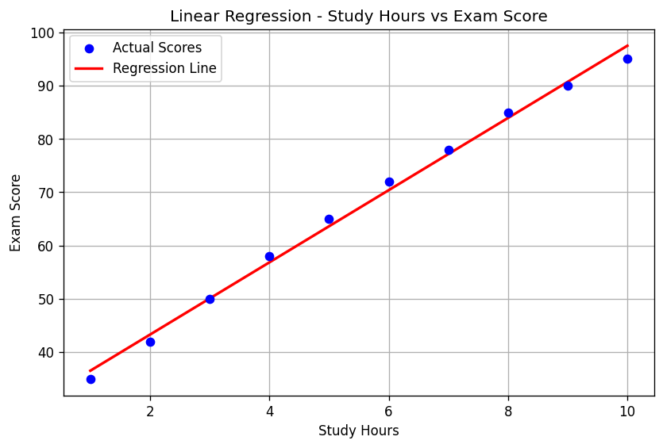

# Linear Regression: Study Hours vs Exam Score

A beginner machine learning project in Python that uses Linear Regression to predict a student's exam score from the number of hours studied.

## What it does
- Creates a small dataset of study hours (1 to 10) and exam scores
- Trains a Linear Regression model using scikit-learn
- Finds the slope and intercept of the best-fit line
- Predicts scores for all the study hours and evaluates the model
- Predicts the score for a new value (6 hours of study)
- Plots the actual scores and the regression line using Matplotlib

## Results
| Metric | Value |
|--------|-------|
| Slope (m) | 6.78 |
| Intercept (b) | 29.73 |
| Equation | y = 6.78x + 29.73 |
| R² Score | 0.9952 |
| MSE | 1.8352 |
| RMSE | 1.3547 |

Prediction: 6 hours of study gives an expected score of **70.39**.

This means that, in this dataset, every extra hour of study increases the exam score by about 6.78 marks.

## Graph


## Tools Used
- Python
- NumPy
- scikit-learn
- Matplotlib

## How to run
1. Install Python from python.org
2. Install the required libraries:
   ```
   pip install numpy matplotlib scikit-learn
   ```
3. Download `linear_regression.py`
4. Run in terminal or command prompt:
   ```
   python linear_regression.py
   ```
5. The results will be printed in the terminal and a graph window will open

## Concepts Practiced
- Linear Regression (slope and intercept)
- Training a model and making predictions
- Model evaluation with R², MSE and RMSE
- Data visualization with Matplotlib
- Working with NumPy arrays

## Note
This project uses a small sample dataset for learning purposes.
